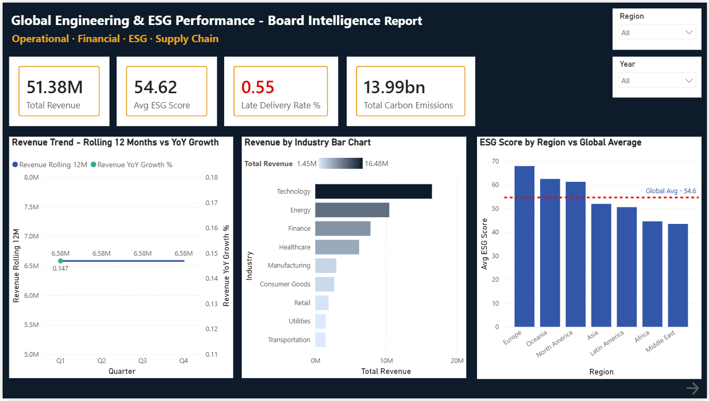
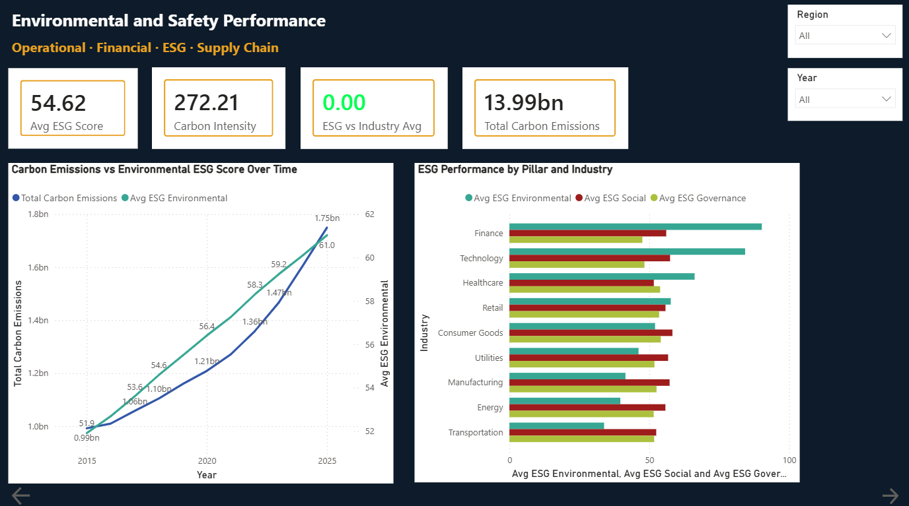
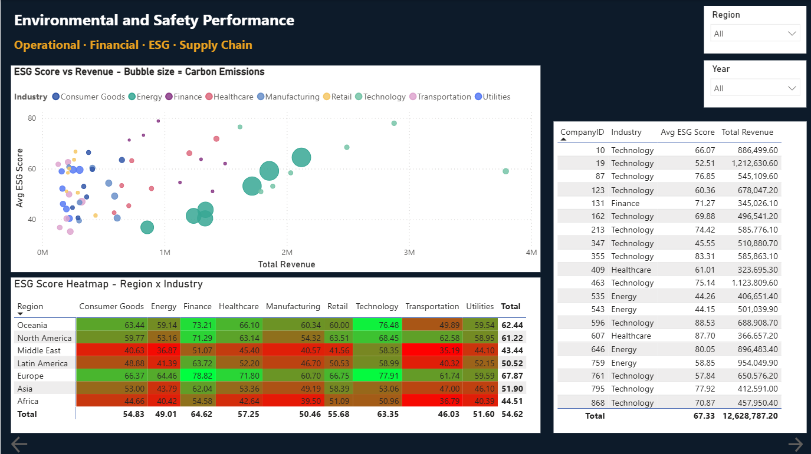
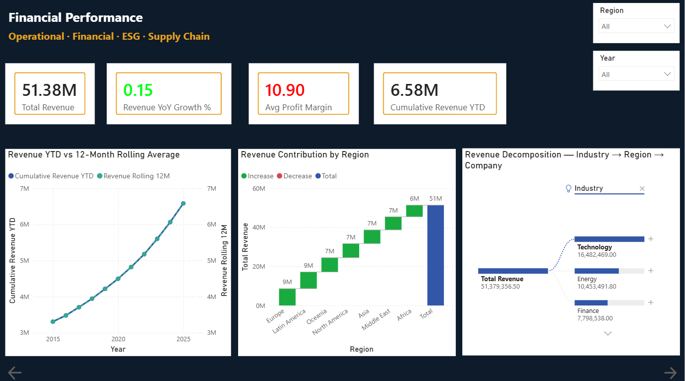
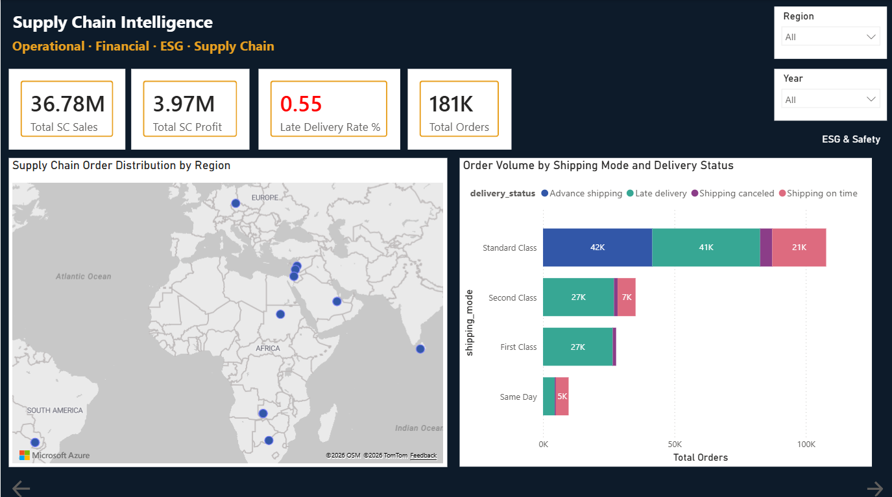

# Global Engineering and ESG Performance
## Board Intelligence Dashboard

**Power BI Portfolio Project | Data Analyst**

---

## Project Overview

An end-to-end Power BI business intelligence dashboard integrating three real-world datasets into a unified semantic model, delivering board-level commercial intelligence across ESG performance, financial analytics, supply chain operations, and macroeconomic context.

> *"Most analysts report on what happened. This project demonstrates the ability to turn operational data into commercial decisions."*

---

## The Business Problem

Engineering and industrial organisations generate vast volumes of operational data but lack analysts who can integrate these sources and translate findings into board-ready commercial insight.

**This dashboard answers five critical board questions:**

1. How is the portfolio performing on ESG and where are the regulatory risks?
2. Which industries and regions are generating the most value?
3. What is driving supply chain late delivery rates above 54%?
4. How does macroeconomic context affect operational performance?
5. Where should the board invest to maximise both ESG and commercial returns?

---

## Datasets

| Dataset | Source | Rows | Period | Key Content |
|---|---|---|---|---|
| ESG and Financial Performance | Kaggle | 11,000 | 2015 to 2025 | 1,000 companies, ESG scores, Revenue, Carbon emissions |
| DataCo Supply Chain (Refined) | Kaggle | 180,519 | 2015 to 2018 | Orders, Sales, Shipping modes, Delivery status |
| World Bank Development Indicators | World Bank Open Data | 17,425 | 1960 to 2025 | GDP, Unemployment, Internet usage, Life expectancy |

---

## Key Findings

- **54.8%** of 180,519 supply chain orders carry late delivery risk, a structural problem not an outlier
- **First Class shipping** has a 95.3% late delivery rate, the worst performing mode despite being the premium option
- **Carbon emissions grew 76%** while revenue grew 99% over 10 years, meaning decarbonisation is lagging behind growth
- **Europe leads ESG** at 67.87 average while Middle East (43.44) and Africa (44.51) are critically behind
- **Technology sector** proves ESG and commercial performance are complementary: highest revenue (£16.5M), highest profit margin (18.80%), second-highest ESG score (63.35)
- **Positive correlation (0.149)** between ESG score and revenue across 11,000 company-year records
- **COVID-19 impact** clearly visible: GDP per capita fell 7.1% in 2020 and recovered 15.5% in 2021

---

## Dashboard Screenshots

### Executive Summary


### ESG and Safety Analytics


### ESG Deep Dive


### Financial Performance


### Supply Chain Intelligence


---

## Technical Stack

| Tool | Purpose |
|---|---|
| Power BI Desktop v2.156.951.0 | Report authoring, semantic modelling, DAX |
| Power Query (M language) | Data ingestion, cleaning, transformation |
| DAX | 20 custom measures across 4 measure groups |
| Power BI Service | Publishing, workspace management, RLS |

---

## Data Model Architecture

Star schema with 3 fact tables, 6 dimension tables, and 9 relationships.

```
                        Dim_Date
                           |
          +----------------+------------------+
          |                |                  |
  Fact_ESG_Financial  Fact_SupplyChain  Fact_MacroEconomic
          |                |
   Dim_Company        Dim_Product
          |
   Dim_Region ---------> Fact_SupplyChain
          |
   Dim_Industry
```

**Model Stats:** 3 fact tables | 6 dimension tables | 9 relationships (8 active, 1 inactive) | 20 DAX measures | 1 What-If parameter | Row Level Security

---

## Repository Structure

```
global-esg-engineering-dashboard/
|
+-- README.md
+-- The_Business_Insights_Report.pdf
+-- Power_BI_Project.pbix
|
+-- datasets/
|   +-- company_esg_financial_dataset.csv
|   +-- DataCoSupplyChainDatasetRefined.csv
|   +-- World_Bank_Development_Indicators.csv
|
+-- screenshots/
    +-- page1_executive_summary.png
    +-- page2_esg_analytics.png
    +-- page3_esg_deepdive.png
    +-- page4_financial_performance.png
    +-- page5_supply_chain.png
```

---

## Dashboard Pages

| Page | Content | Skills Demonstrated |
|---|---|---|
| Executive Summary | KPI cards, Revenue trend, ESG by region | Conditional formatting, Sync slicers |
| ESG and Safety Analytics | Carbon emissions, ESG sub-scores, Scatter chart | Custom tooltips, Reference lines |
| ESG Deep Dive | ESG heatmap matrix by region and industry | Gradient conditional formatting |
| Financial Performance | Waterfall, Decomposition tree, What-If scenario | Time intelligence, Top N filter |
| Supply Chain Intelligence | Map, Bookmark toggle, Gauge, Combo chart | USERELATIONSHIP, Bookmarks |
| Macro Economic Context | GDP trend, Unemployment, Scatter by country | World Bank data integration |
| Company Detail | Drillthrough destination page | Drillthrough, Back button navigation |

---

## Technical Capabilities Demonstrated

**Data Preparation**
Connected 3 CSV sources with correct locale settings for US date format. Built staging queries to resolve Expression.Error on reference queries. Created Dim_Date table in M from scratch. Applied Privacy levels across all sources.

**Data Modelling**
Designed star schema with correct cardinalities across 9 relationships including active and inactive. Wrote 20 DAX measures including time intelligence, USERELATIONSHIP, and CALCULATE with ALL(). Built What-If parameter for ESG investment scenario modelling.

**Visualisation and Analysis**
Built report pages with 30+ visuals. Implemented drillthrough, custom tooltips, and bookmark toggles. Applied conditional formatting with rule-based logic. Configured sync slicers across all pages. Built decomposition tree and waterfall chart for financial analysis.

**Deployment and Governance**
Published to dedicated Power BI Service workspace. Configured Row Level Security with Regional Manager role. Set up scheduled refresh via Personal Data Gateway. Created and published App for stakeholder distribution. Endorsed dataset as Promoted.

---

## Commercial Recommendations

Five board-level recommendations grounded entirely in the data are detailed in the Business Insights Report:

1. **Critical:** Investigate First Class shipping immediately. A 95.3% late delivery rate requires urgent operational review.
2. **High:** Launch Energy sector decarbonisation programme. 9.73B carbon units is the largest single source.
3. **Medium:** Target Africa and Middle East ESG investment. Both are 20 or more points below European peers.
4. **Operational:** Redirect shipping capacity from First Class to Standard Class, which has only a 38.1% late rate.
5. **Strategic:** Use Technology sector as the internal ESG blueprint. It already proves the commercial case.

Full findings and recommendations: [Business_Insights_Report.pdf](Business_Insights_Report.pdf)

---

## Skills Demonstrated

**Technical:** Power Query (M), DAX, Power BI, Data Modelling, Star Schema Design, Row Level Security

**Domain Knowledge:** HSE Risk Analytics, ESG Reporting, Engineering Operations, Process Safety, KPI Framework Design

**Commercial:** Board-level presentation, Stakeholder communication, Insight-to-action translation, Risk quantification

---

## About the Analyst

**John Salter Oseyi** is a Data Analyst with a Civil Engineering and HSE background, combining 5+ years of operational domain expertise with technical analytics capability to deliver analysis that engineering and industrial organisations can act on.

- LinkedIn: [linkedin.com/in/johnsalteroseyi](https://linkedin.com/in/johnsalteroseyi)
- Email: john.salteroseyi@outlook.com
- Location: Leeds, England, UK

---

*Built with Power BI Desktop v2.156.951.0. Datasets sourced from Kaggle and World Bank Open Data. October 2026.*
